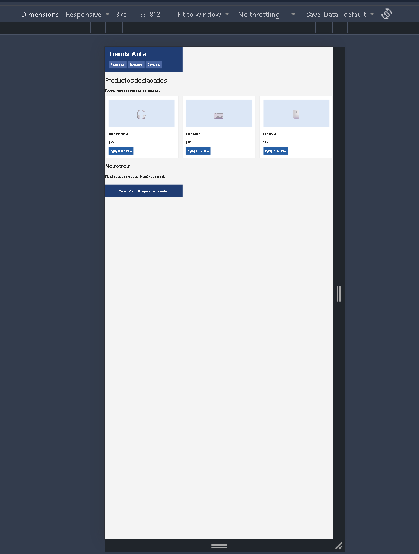
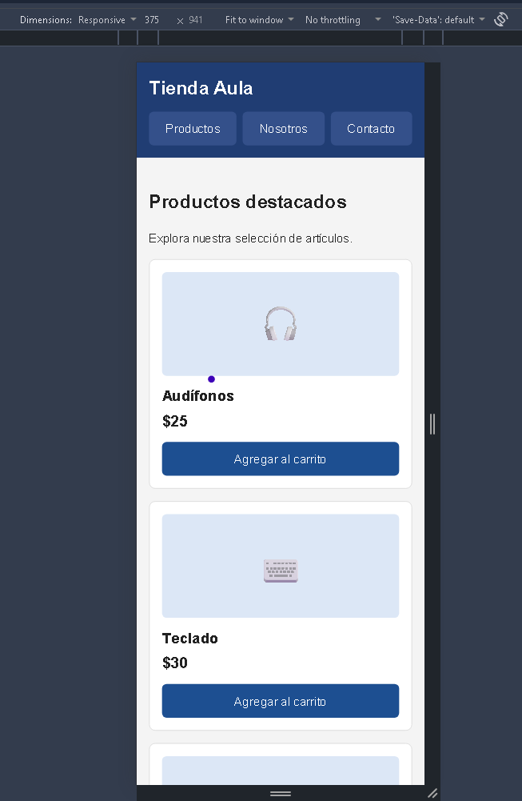
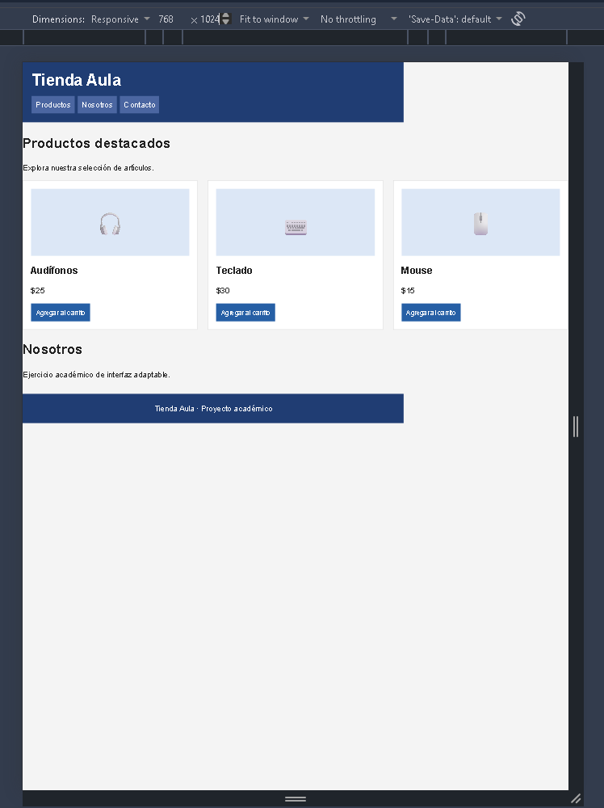
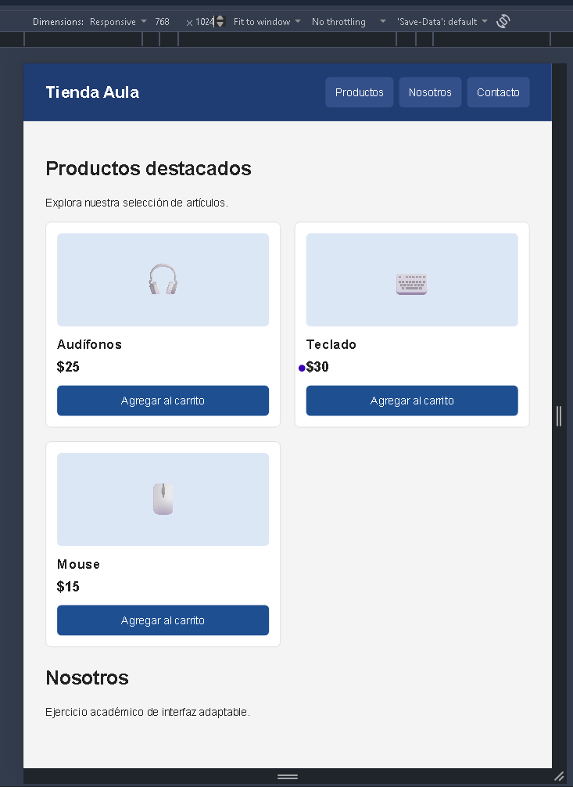
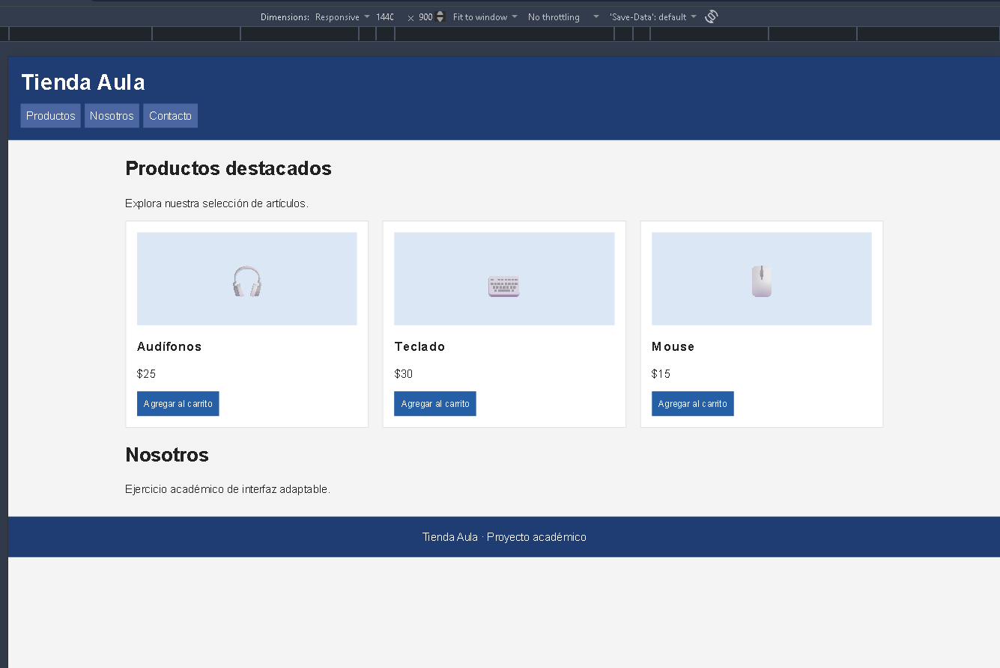
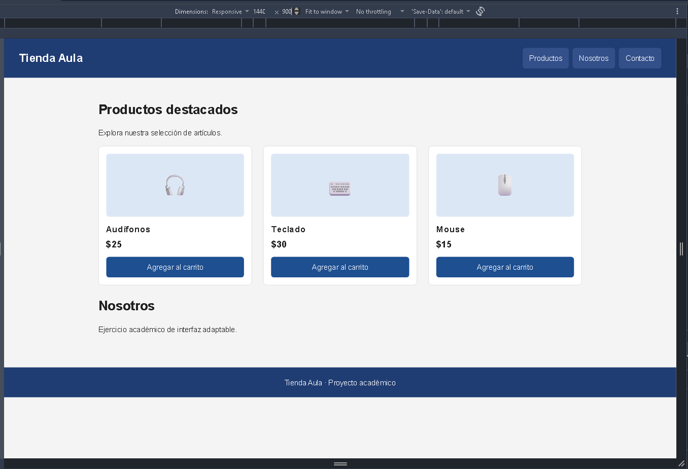
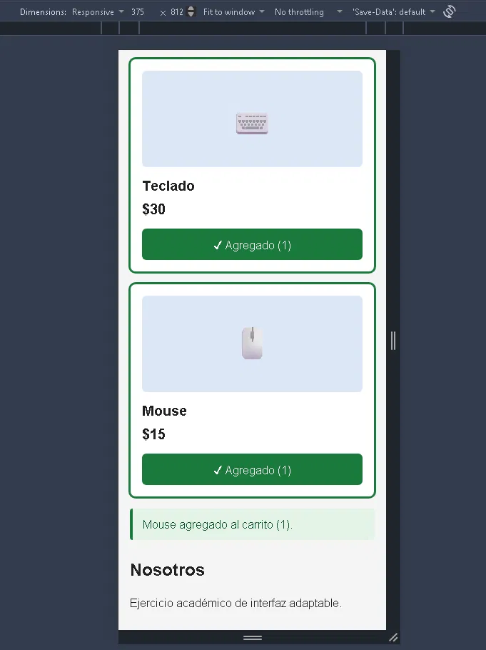

# Tienda Aula — Reto responsive

Taller de transformación responsive (Clase 2). Se partió de una interfaz de tienda deliberadamente poco adaptable y se convirtió a diseño **Mobile First** conservando HTML semántico y principios HCI.

## Estructura

```
tienda-responsive/
├── index.html
├── styles.css
├── README.md
└── capturas/
    ├── antes-375.png / antes-768.png / antes-1440.png
    ├── despues-375.png / despues-768.png / despues-1440.png
    └── despues-375-agregado.png
```

## Problemas del diseño inicial
- `main` con `width: 1100px` fijo: provocaba desbordamiento horizontal en móvil y tablet.
- Cuadrícula de 3 columnas fija, sin adaptarse al espacio disponible.
- Navegación y botones pequeños, difíciles de tocar.
- Sin retroalimentación visual clara al agregar un producto.

## Cambios realizados
- **Mobile First:** los estilos base son para móvil (1 columna) y las media queries solo añaden mejoras con `min-width`.
- **Media queries:** `768 px` pasa a 2 columnas y coloca el header en una fila; `1024 px` pasa a 3 columnas. Se eligieron esos puntos porque es donde hay espacio real para más columnas.
- `main` ahora usa `width: 100%` con `max-width: 1100px` y `padding`, sin desbordamiento.
- HTML semántico conservado (`header`, `nav`, `main`, `section`, `footer`) con `aria-labelledby` en las secciones.
- Botones y enlaces de mínimo 44 px de alto, foco visible (`:focus-visible`) y contraste reforzado.
- El `onclick` inline se reemplazó por `addEventListener` con `data-nombre`.

## ¿Por qué Grid y Flexbox?
- **Grid** para el catálogo de productos: es un diseño bidimensional (filas y columnas) y cambiar de 1 a 2 y 3 columnas solo requiere modificar `grid-template-columns`.
- **Flexbox** para el header y la navegación: son elementos en una sola dimensión que deben alinearse, repartirse el ancho y bajar de línea (`flex-wrap`) si no caben.

## Dos mejoras HCI
1. **Objetivos táctiles grandes y botón a ancho completo en móvil** (ley de Fitts): reduce errores al tocar y facilita el uso con una mano.
2. **Visibilidad del estado del sistema:** al agregar un producto la tarjeta se resalta en verde, el botón confirma "✔ Agregado (n)" y aparece un mensaje con `aria-live`, que además lo anuncian los lectores de pantalla.

## Pruebas (Chrome DevTools)
Sin scroll horizontal en los tres tamaños.

| Tamaño | Antes | Después |
|---|---|---|
| 375 × 812 (móvil) |  |  |
| 768 × 1024 (tablet) |  |  |
| 1440 × 900 (escritorio) |  |  |

Retroalimentación al agregar productos (R7):



## Cómo ejecutar
Abrir `index.html` en el navegador. No requiere instalación.
